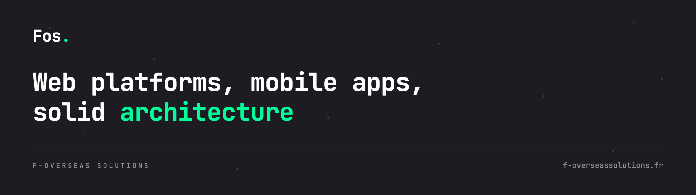

 

**Digital agency based near Paris.** 
We design, build and ship web platforms, mobile apps and solid architecture.

 

&nbsp;

 

## What we do

| Service | What that means |
| :--- | :--- |
| **Web development** | Showcase sites, e-commerce and complex platforms, built to perform. |
| **Mobile development** | Native-feeling iOS and Android apps, from ideation to the stores. |
| **Architecture consulting** | Robust, scalable systems designed around what you already run. |

## What we build with

**Languages &amp; frameworks**

  
  
  
  
  
  
  

**Cloud &amp; delivery**

  
  
  

## Open source

What we can share sits in the pinned repositories below — starting with the
source of our own website, running in production.

 

### Tell us what you're building

 

Clamart 92140, France · <a href="mailto:contact@f-overseassolutions.fr">contact@f-overseassolutions.fr</a>

